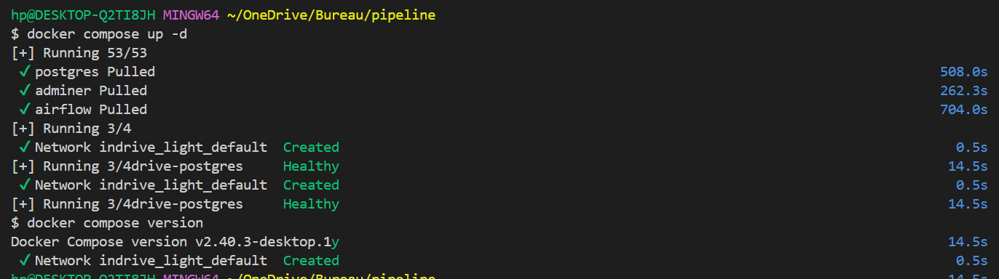
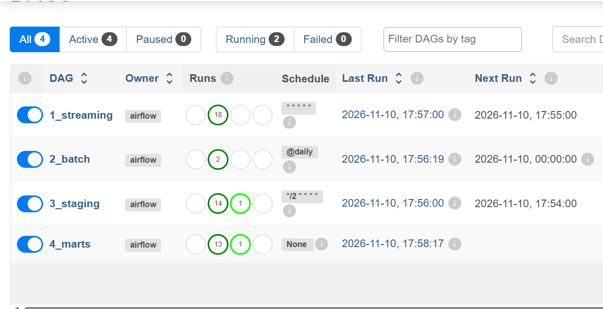
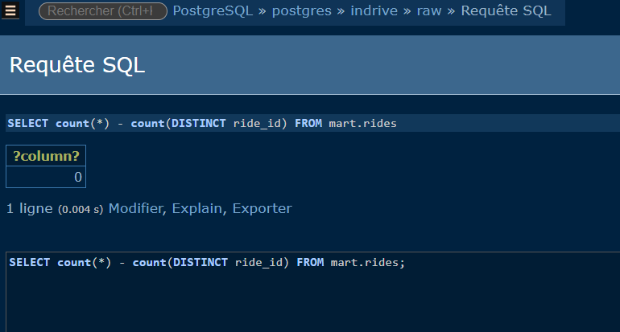

# WORKSHEET - Pipeline InDrive

Note : source streaming = API Mockaroo (au lieu de DummyJSON)

## Q1 - Batch / streaming / fait / dimensions
- Batch : drivers, vehicles, zones (référentiels CSV, changent rarement, rechargés 1 fois par jour).
- Streaming : rides (événements en continu, API chaque minute).
- Traités différemment : fréquence de changement et volume différents.
- Fait : rides. Dimensions : drivers, vehicles, zones.

## Q2 - ETL ou ELT ?
ELT : on charge les données brutes dans Postgres (raw), puis on transforme dans la base en SQL (staging, mart).

## Q3 - Grain de mart.rides
Une ligne = une course valide (ride_id unique, tarif > 0, chauffeur existant), avec le nom du chauffeur et la zone de départ.

## Q4 - Comptage
- raw.rides = 250, staging.rides = 221.
- Filtrées : 11 tarifs <= 0, 9 chauffeurs inconnus, 0 doublon.
- Écart restant : le streaming ajoute des lignes dans raw chaque minute, staging ne se reconstruit que toutes les 2 minutes (comptages à des instants différents).
- Filtrer dans staging : la règle est visible, centralisée, réutilisée par tous les marts et auditable. Un JOIN supprimerait les lignes sans laisser de trace.

## Q5 - Relancer 3_staging 3 fois
DROP + CREATE TABLE AS reconstruit toute la table à chaque run : même résultat, pas de doublon (idempotent). Avec INSERT INTO, chaque run réinsérerait toutes les courses : doublons, SUM et COUNT gonflés.

## Q6 - Additivité
- fare_amount : additif (SUM valable sur toutes les dimensions).
- rating : non-additif (c'est une moyenne). SUM(rating) n'a pas de sens et dépend du nombre de courses. On utilise AVG(rating).

## Preuve
1. Lancement : `docker compose up -d` (3 conteneurs : postgres, adminer, airflow).

2. Les 4 DAGs (1_streaming, 2_batch, 3_staging, 4_marts) sont verts, sans échec.

3. Après relance de 2_batch et plusieurs exécutions de 3_staging / 4_marts, aucun doublon :
- `SELECT count(*) - count(DISTINCT ride_id) FROM mart.rides;` renvoie 0.
- `SELECT count(*) FROM raw.drivers;` renvoie 8 avant et après la relance (pas 16).

